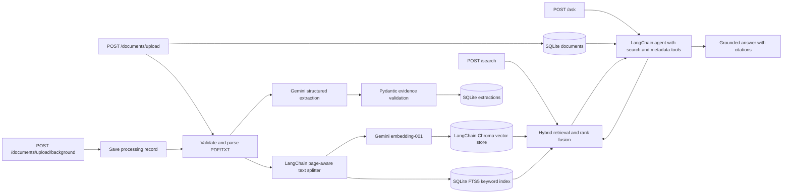

# Document Intelligence API

A local FastAPI application for PDF/TXT uploads, Pydantic-validated information extraction, Gemini embeddings, semantic search, and grounded question answering.

## Architecture



SQLite stores operational document metadata, validated business facts, and an FTS5 keyword index of chunks. Chroma stores chunk text, embeddings, and source identifiers. An upload is marked `ready` only after extraction and both indexes succeed. Failed uploads stay visible with a `failed` status; partial index entries are removed when possible. On startup, ready documents from older versions are added to the keyword index from their stored Chroma chunks. The original upload is stored locally under `data/uploads/`.

## Setup

Requires Python 3.10+ and a Gemini API key. Gemini calls can incur API charges and send uploaded document text to Google.

```bash
git clone https://github.com/Bansal0527/live2-rag.git
cd live2-rag
python3 -m venv .venv
source .venv/bin/activate
pip install -e '.[test]'
cp .env.example .env
```

Replace `replace-with-your-key` in `.env` with your Gemini API key. You can also set `GOOGLE_API_KEY` (or `GEMINI_API_KEY`) in your shell. Start the API from the repository root:

```bash
python -m uvicorn app.main:app --reload
```

Open [Swagger UI](http://127.0.0.1:8000/docs). Data is saved in `./data` by default. `GEMINI_CHAT_MODEL` defaults to `gemini-3.5-flash` and can be changed without changing code.

## API

| Method and path | Purpose |
| --- | --- |
| `POST /documents/upload` | Multipart `file`; process PDF or UTF-8 TXT synchronously |
| `POST /documents/upload/background` | Multipart `file`; return `202` with a `processing` record and process after the response |
| `GET /documents` | List document IDs, filenames, timestamps, counts, and status |
| `GET /documents/{id}` | Get operational metadata and extracted information |
| `POST /search` | Hybrid keyword and semantic search with optional document filters |
| `POST /ask` | Answer from retrieved chunks and return verified source references |

Example:

```bash
curl -F 'file=@samples/employment_agreement.txt' http://127.0.0.1:8000/documents/upload
curl -F 'file=@samples/vendor_terms.txt' http://127.0.0.1:8000/documents/upload
curl -F 'file=@samples/company_policy.pdf' http://127.0.0.1:8000/documents/upload/background
curl http://127.0.0.1:8000/documents
curl -H 'Content-Type: application/json' -d '{"query":"What is the notice period?"}' http://127.0.0.1:8000/ask
curl -H 'Content-Type: application/json' -d '{"query":"notice period","filters":{"document_type":"Employment Agreement","file_type":"txt"}}' http://127.0.0.1:8000/search
```

Files in `samples/` are fictional demo fixtures created for this project.

The background upload response includes an ID. Poll `GET /documents/{id}` until its status is `ready` or `failed`; a failed record includes an error. Basic file checks run before `202`; parsing, extraction, and indexing run in the background.

Both `/search` and `/ask` accept `filters` with optional `name`, `file_type` (`pdf` or `txt`), and `document_type` fields. Fields are combined with AND; `name` matches the full filename and both `name` and `document_type` match case-insensitively. `document_type` is the value from validated information extraction. The existing `document_ids` field can be combined with these filters. SQLite selects matching ready documents, then both Chroma and FTS5 search only their IDs. A filter with no matches returns no search results or an insufficient-evidence answer.

`/ask` returns `{"answer": null, "sources": [], "status": "insufficient_evidence"}` when retrieval finds no relevant chunks or the model cannot provide a valid source citation. Each source includes the document ID/name, page (null for TXT), chunk ID, supporting text, optional vector `similarity`, and fused `relevance_score`. HTTP 422 covers invalid or empty files, 413 covers configured size limits, 502 covers Gemini/index failures or invalid model output, and 504 covers timeouts.

## Design choices

- **Gemini embedding-001:** text-only retrieval fits this assignment. The LangChain adapter uses `RETRIEVAL_DOCUMENT` and `RETRIEVAL_QUERY` for the respective inputs. Default 3072-dimensional embeddings avoid extra normalization logic. The model's 2,048-token input limit is well above our 1,200-character chunk target.
- **Chunking:** `RecursiveCharacterTextSplitter` splits LangChain `Document` objects inside each PDF page at roughly 1,200 characters with 180-character overlap. This preserves precise page citations and keeps a nearby clause from being cut in two.
- **RAG flow:** A LangChain agent receives `search_documents` and `list_document_metadata` tools. Metadata comes from SQLite and respects the request filters; the agent can list eligible records or request one by ID. It returns a Pydantic answer with chunk IDs. The API accepts citations only for chunks actually returned by search.
- **Relevance:** Chroma uses cosine distance. The API converts it to `1 - distance` and uses `MIN_SIMILARITY` (default `0.30`) as an initial vector cutoff. SQLite FTS5 ranks keyword matches with BM25. Reciprocal rank fusion combines the top results from both lists; a chunk found by both methods receives a higher rank. `relevance_score` is a normalized fusion score, not a probability. `similarity` is null for keyword-only results. Optional metadata and `document_ids` filtering applies to both indexes. The cutoff and fusion ranking should be tuned with representative questions.
- **Hallucination controls:** extraction requires a verbatim evidence quote on the cited page. Q&A uses retrieved chunks only, can abstain, and accepts citations only if their chunk IDs came from retrieval. This checks source identity and evidence location; it cannot prove every sentence is logically entailed by the quote.
- **Failure behavior:** malformed extraction is retried once. Provider and embedding failures return a clear error; document records remain in `failed` state for inspection. There is no distributed transaction across SQLite and Chroma, so cleanup is best effort.

## Scope and limitations

Synchronous and background upload routes share the same 5 MiB maximum file size and 100,000-character maximum extracted text by default. FastAPI background tasks run in the API process; an interrupted process can leave a record at `processing`, so production deployment would need a durable job queue and recovery. Scanned/image-only PDFs need OCR and are rejected as empty when no text layer exists. Complex tables and multi-column PDFs may have imperfect reading order. There is no authentication or tenant isolation; run this locally with non-sensitive test data. A dedicated model-based reranker is not included; RRF combines the keyword and vector rankings.

## Tests

```bash
python -m pytest -q
```

See [test results](TEST_RESULTS.md) for the latest automated and live evaluation outcomes. A readable [Codex coding-session export](docs/CODEX_SESSION.md) is included with the submission.

Tests use fake Gemini and vector components, so they run without an API key. They cover uploads, background status and failure, metadata and agent tools, grounded citations, missing answers, cross-document search and filtering, invalid files, provider failure, and evaluation scoring.

Run the optional 10-question live evaluation against the three fictional sample documents with:

```bash
python -m evaluation.run
```

It creates a temporary database, calls the real Gemini services, and writes `evaluation/results.json` locally. The report includes each uploaded document's metadata and extraction, plus each question, expected answer, full API response, and a source-reference check. It saves progress after each request and retries temporary API failures. The simple scorer checks key terms from the expected answer, answer status, and source documents; it accepts different wording. This requires an API key and available Gemini quota; it can incur charges. The automated tests validate the evaluator without calling Gemini.
